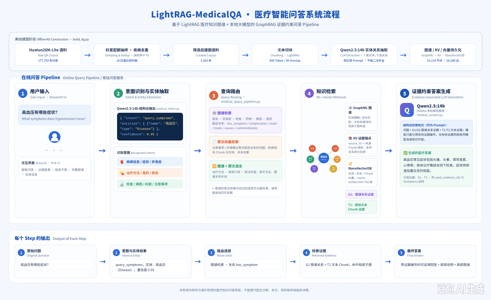
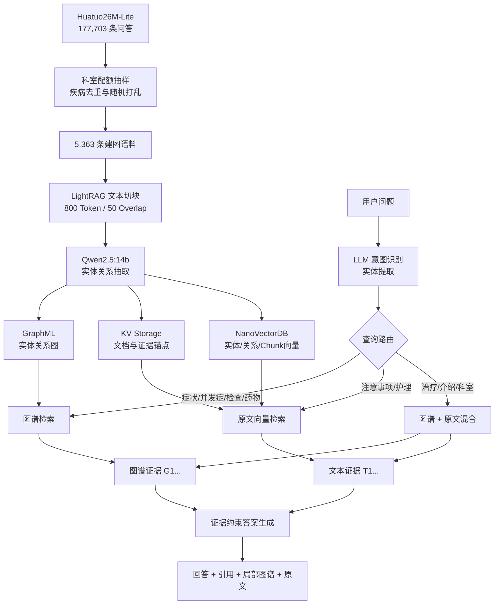
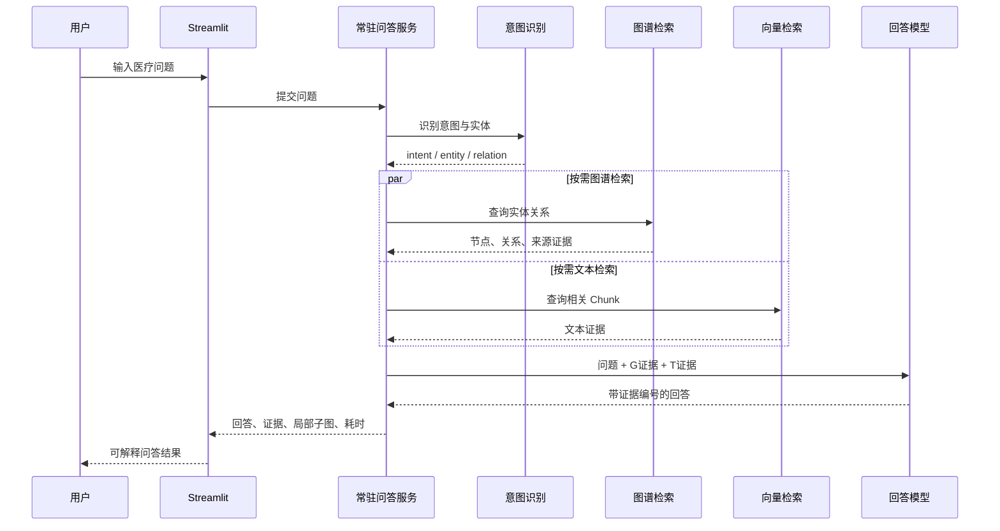
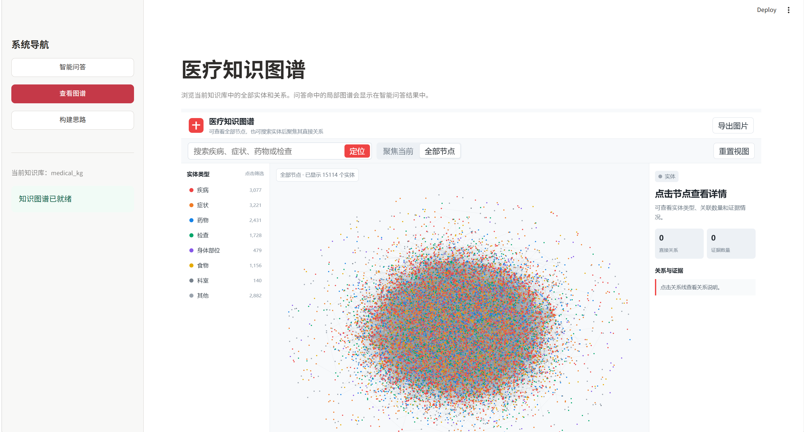
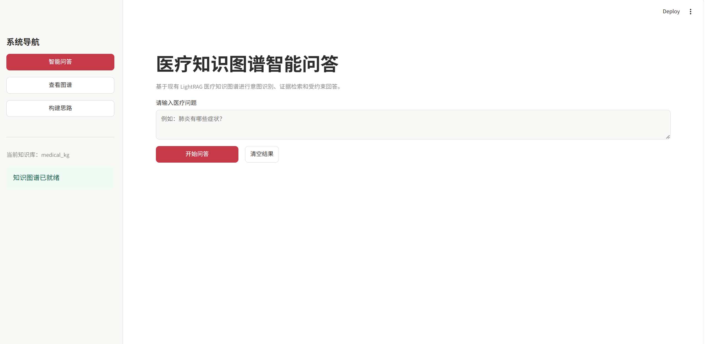

<div align="center">

# 🏥 LightRAG-MedicalQA

### 基于 LightRAG、医疗知识图谱与本地大模型的中文医疗智能问答系统

<br>

[](https://www.python.org/)
[](https://github.com/HKUDS/LightRAG)
[](https://ollama.com/)
[](https://qwenlm.github.io/)
[](https://streamlit.io/)
[](LICENSE)

<br>

**自主文本建图** · **GraphRAG + 向量检索** · **证据约束回答** · **图谱可视化** · **本地离线推理**

<br>



<br>

[快速开始](#-快速开始) · [系统架构](#️-系统架构) · [核心模块](#-核心模块详解) · [质量评测](#-质量检测与正式评测) · [配置说明](#️-配置与环境变量)

</div>

---

## 💡 项目简介

本项目构建了一套基于 **LightRAG + 医疗知识图谱 + 本地大语言模型** 的中文医疗智能问答系统。

系统以 Huatuo26M-Lite 中文医疗问答语料为基础，不直接导入现成医疗三元组，而是使用本地运行的 `qwen2.5:14b` 从原始文本中自动抽取疾病、药物、症状、检查等实体及其关系，构建医疗知识图谱；查询阶段再根据问题意图，在知识图谱检索、原文向量检索和混合检索之间进行路由，最后由大模型仅根据检索证据生成回答。

与单纯依赖大模型内部知识的问答方式相比，本项目强调：

- **知识来源可追溯**：答案能够回溯到图谱关系或原始文本 Chunk；
- **实体关系可查看**：问答结果可展示本次命中的局部知识图谱；
- **降低医疗幻觉**：从 Prompt、切块、Schema、抽取轮次和证据校验多个层面约束模型。

> [!WARNING]
> 本项目属于研究与演示性质的医疗知识问答原型，不能替代医生诊断、处方、用药指导或临床决策。

---

## 📊 当前成果

| 指标 | 当前结果 |
|---|---:|
| 筛选后建图语料 | 5,363 条 |
| 图谱实体节点 | **15,114** |
| 图谱关系边 | **26,580** |
| 有逐字原文支持的关系 | 24,116 条 |
| 疑似幻觉关系 | 2,464 条 |
| 疑似幻觉率 | **9.3%** |
| 固定检索评测集 | 32 条 |
| 检索评测通过率 | **32 / 32** |
| 平均检索延迟 | **4.26 秒** |
| 检索 P95 延迟 | **4.87 秒** |

> [!NOTE]
> 9.3% 是基于“关系两端是否逐字出现在来源文本中”的自动化疑似幻觉率，不等同于临床事实错误率。32 / 32 是当前内部固定评测集上的检索与路由结果，也不代表临床医学准确率。

---

## ✨ 核心特性

<table>
<tr>
<td width="50%">

**🧬 自主医疗文本建图**
从中文医疗问答文本中自动抽取实体和关系，不依赖现成三元组库。

**🕸️ GraphRAG + 向量检索**
结构化问题查询知识图谱，复杂建议类问题检索原始文本。

**🛡️ 四层防幻觉机制**
关闭二次补全、严格 Prompt、缩小切块、固定中文输出。

**🔎 证据回溯**
图谱关系可以回溯到来源 Chunk，回答引用 `G1`、`T1` 等证据编号。

</td>
<td width="50%">

**🧠 LLM 意图识别**
识别症状、药物、并发症、检查、治疗方法、注意事项等意图。

**⚡ 常驻问答服务**
图谱、KV 和向量库只初始化一次，连续提问复用同一 Pipeline。

**🎨 完整中文 UI**
支持智能问答、证据查看、局部图谱、完整图谱和实体信息。

**📋 版本化正式评测**
固定评测集输出 JSON 和 Markdown 报告，可用于模型与 Prompt 对比。

</td>
</tr>
</table>

---

## 📋 目录

<details>
<summary><b>点击展开完整目录</b></summary>

- [项目简介](#-项目简介)
- [当前成果](#-当前成果)
- [核心特性](#-核心特性)
- [快速开始](#-快速开始)
- [系统架构](#️-系统架构)
- [项目结构](#-项目结构)
- [医疗 Schema](#-医疗-schema)
- [防幻觉设计](#️-防幻觉设计)
- [核心模块详解](#-核心模块详解)
- [查询路由策略](#-查询路由策略)
- [图谱可视化](#️-图谱可视化)
- [质量检测与正式评测](#-质量检测与正式评测)
- [配置与环境变量](#️-配置与环境变量)
- [安全须知](#-安全须知)
- [已知限制](#️-已知限制)
- [路线图](#️-路线图)
- [致谢](#-致谢)
- [许可证](#-许可证)

</details>

---

## 🚀 快速开始

> [!IMPORTANT]
> 系统运行需要以下三项准备完成：
>
> | # | 依赖 | 缺失后的影响 |
> |---|---|---|
> | 1 | Ollama + `qwen2.5:14b` | 无法进行意图识别、知识抽取和答案生成 |
> | 2 | `nomic-embed-text` | 无法构建或查询向量库 |
> | 3 | 医疗语料或已构建的 `medical_kg/` | 无法构建和查询知识库 |

### 步骤 1：准备 Python 环境

项目基于 LightRAG 源码开发，要求 Python 3.10 及以上。

```powershell
git clone <你的仓库地址>
cd LightRAG

uv sync --extra offline-llm
uv pip install --python .venv\Scripts\python.exe streamlit pyvis
```

### 步骤 2：安装并准备 Ollama 模型

```powershell
ollama pull qwen2.5:14b
ollama pull nomic-embed-text
ollama list
```

如果 Ollama 没有自动启动：

```powershell
ollama serve
```

### 步骤 3：准备医疗语料

将筛选后的 JSONL 数据放在：

```text
data/sample_6000.jsonl
```

每行格式示例：

```json
{
  "id": 22647835,
  "label": "眼耳鼻喉科",
  "related_diseases": "鼻中隔偏曲",
  "question": "请问如何治疗鼻中隔偏曲？",
  "answer": "治疗可分为手术和非手术方式……"
}
```

当前筛选策略为按 16 个科室比例抽样、每科设置 200～600 条上限、同疾病去重，并在建图前用固定随机种子打乱。原始 177,703 条最终筛选为 5,363 条。

> [!NOTE]
> `data/` 已被 `.gitignore` 忽略。发布项目时请根据数据集许可单独说明数据获取方式，不建议直接提交大体积原始语料。

### 步骤 4：构建医疗知识图谱

```powershell
.\.venv\Scripts\python.exe .\build_kg.py
```

默认使用：

```text
LLM                 qwen2.5:14b
Embedding           nomic-embed-text（768 维）
Chunk               800 Token / 50 Overlap
二次抽取轮数        0
工作目录            medical_kg
```

### 步骤 5：生成图谱并检测质量

```powershell
.\.venv\Scripts\python.exe .\view_graph.py
.\.venv\Scripts\python.exe .\check_hallucination.py
.\.venv\Scripts\python.exe .\show_edges_with_text.py
```

### 步骤 6：启动智能问答系统

```powershell
.\.venv\Scripts\streamlit.exe run streamlit_app.py
```

浏览器访问：

```text
http://localhost:8501
```

Streamlit 启动时会创建常驻问答服务并预加载图谱、KV 和向量库，页面切换和连续提问不会重复加载全部知识库。

---

## 🏗️ 系统架构



### 查询时序



---

## 📁 项目结构

以下仅列出本项目在 LightRAG 仓库中新增或重点修改的文件：

```text
LightRAG/
├── build_kg.py                    # 医疗语料建图
├── check_hallucination.py         # 关系原文回溯与幻觉率检测
├── show_edges_with_text.py        # 导出关系与来源文本核查网页
├── view_graph.py                  # 生成完整图谱页面
├── streamlit_app.py               # Streamlit 用户界面
│
├── medical_intent.py              # 意图识别与实体抽取
├── medical_graph_query.py         # GraphML 关系查询与实体别名匹配
├── medical_query_pipeline.py      # 图谱/文本/混合检索路由
├── medical_answer.py              # 证据约束回答生成
├── medical_qa_service.py          # 常驻 Pipeline 与事件循环
├── medical_graph_ui.py            # 全局图与局部图交互组件
├── medical_eval.py                # 正式评测入口
│
├── medical_evaluation/
│   ├── benchmark_v1.json          # 32 条固定评测问题
│   ├── README.md                  # 评测使用说明
│   └── reports/                   # 评测报告（默认忽略）
│
├── medical_kg/                    # 图谱、KV、向量库（默认忽略）
├── data/                          # 原始及筛选语料（默认忽略）
│
└── lightrag/prompt.py             # 医疗实体类型、关系和防幻觉规则
```

---

## 🧬 医疗 Schema

### 实体类型

| 类型 | 中文含义 | 示例 |
|---|---|---|
| `Disease` | 疾病 | 高血压、糖尿病、肺炎 |
| `Drug` | 药物 | 硝苯地平、胰岛素、阿司匹林 |
| `Symptom` | 症状 | 头痛、咳嗽、发热 |
| `BodyPart` | 身体部位 | 心脏、肝脏、肺部 |
| `Exam` | 医疗检查 | CT、血常规、血压测量 |
| `Food` | 食物或饮食因素 | 高盐食物、燕麦 |
| `Department` | 医疗科室 | 心血管内科、呼吸内科 |

### 关系类型

| 关系 | 含义 | 推荐方向 |
|---|---|---|
| `treats` | 治疗药物 | Disease → Drug |
| `has_symptom` | 相关症状 | Disease → Symptom |
| `causes` | 病因或导致 | Cause → Disease |
| `complication` | 并发症 | Disease → Disease |
| `exam` | 相关检查 | Disease → Exam |
| `contraindicates` | 用药禁忌 | Drug → Disease |

实体和关系使用受控 Schema，避免模型自由生成大量难以维护的类别。

---

## 🛡️ 防幻觉设计

| 层级 | 措施 | 目的 |
|---|---|---|
| 抽取轮次 | `entity_extract_max_gleaning=0` | 关闭二次补全，减少模型凭常识追加事实 |
| Prompt | 两端实体必须在原文出现 | 阻止无来源关系进入图谱 |
| Prompt | 禁止医学常识推断 | 只抽取文本明确表达的信息 |
| Prompt | 禁止关系类型作为实体 | 避免 `treats` 等 Schema 词污染节点 |
| Prompt | 强制中文实体 | 避免同一实体产生中英文重复节点 |
| 切块 | 800 Token + 50 Overlap | 减少跨问题、跨疾病的信息拼接 |
| Schema | 7 类实体 + 6 类关系 | 限制抽取空间，便于查询和评测 |
| 证据 | 保存 `source_id` 与 Chunk 映射 | 支持关系原文回溯 |
| 回答 | 只能引用有效 `G*` / `T*` 证据 | 减少回答阶段自由发挥 |

核心 Prompt 修改位于 `lightrag/prompt.py`。

---

## 🔧 核心模块详解

### 1. 医疗知识图谱构建

`build_kg.py` 将每条问答格式化为：

```text
科室：心血管内科
相关疾病：高血压
问题：……
回答：……
```

随后通过 LightRAG 完成：

```text
文档入队 → 文本切块 → LLM抽取 → 实体合并 → 关系合并
       → Embedding → Graph/KV/Vector 持久化
```

建图前使用固定随机种子 `42` 打乱数据，避免按科室顺序构建导致早期偏科。

### 2. 意图识别

`medical_intent.py` 使用 Qwen 输出结构化 JSON：

```json
{
  "intent": "query_complications",
  "entities": [
    {"name": "高血压", "type": "Disease"}
  ],
  "confidence": 0.95
}
```

支持的主要意图：

```text
query_symptoms
query_drugs
query_causes
query_complications
query_exams
query_contraindications
query_department
disease_overview
treatment_advice
precautions
other
```

### 3. 图谱检索

`medical_graph_query.py` 直接读取 GraphML，并提供：

- 实体精确匹配；
- 大小写匹配；
- 包含式别名匹配；
- 关系级实体别名回退；
- 目标实体类型过滤；
- 关系权重排序；
- 来源 Chunk 回溯；
- 局部子图构造。

例如图库同时存在“普通感冒”和“感冒”，但治疗关系只存在于“感冒”节点时，系统会在“普通感冒”没有 `treats` 结果后回退到“感冒”。

### 4. 原文与混合检索

`medical_query_pipeline.py` 使用 LightRAG 的 `naive` 或 `hybrid` 模式查询 Chunk、实体和关系向量，并统一整理为：

```text
intent
graph_queries
text_retrieval
route_used
fallback_reason
```

### 5. 证据约束回答

`medical_answer.py` 将检索结果整理为：

```text
G1：图谱关系证据
G2：图谱关系证据
T1：原始文本证据
T2：原始文本证据
```

回答模型必须输出：

```json
{
  "answer": "……",
  "used_evidence_ids": ["G1", "T1"],
  "limitations": "当前证据未覆盖……"
}
```

系统会过滤不存在的证据编号。如果没有有效证据，则拒绝基于模型自身知识生成确定性答案。

### 6. 常驻问答服务

`medical_qa_service.py` 在后台线程中维护一个长期事件循环：

```text
Streamlit 启动
    ↓
创建后台事件循环
    ↓
创建一个 MedicalQueryPipeline
    ↓
预加载 Graph / KV / Vector Storage
    ↓
所有问题复用同一实例
```

该设计解决了：

- 每次问题重复加载数百 MB 存储；
- Streamlit 重跑导致 Pipeline 重建；
- Ollama `AsyncClient` 跨事件循环导致 `Event loop is closed`；
- 多个请求同时访问共享存储的问题。

当前服务串行处理查询，以保护共享的文件存储和异步工作队列。

---

## 🔀 查询路由策略

| 用户意图 | 图谱关系 | 检索方式 |
|---|---|---|
| 查询症状 | `has_symptom` | 图谱检索 |
| 查询并发症 | `complication` | 图谱检索 |
| 查询检查 | `exam` | 图谱检索 |
| 查询药物 | `treats` | 图谱检索 |
| 查询病因 | `causes` | 图谱检索 |
| 查询禁忌 | `contraindicates` | 图谱检索 |
| 治疗方法 | `treats` + 原文 | 原文为主、图谱补充 |
| 注意事项 | 无固定关系 | 原文检索 |
| 疾病介绍 | 多类关系 + 原文 | 混合检索 |
| 就诊科室 | 原文与实体信息 | 混合检索 |

图谱检索无结果时，系统会回退到原文向量检索，避免直接返回空答案。

---

## 🖥️ 图谱可视化

全局图谱与问答局部图谱使用统一的中文交互界面。

### 全部节点

显示完整的 15,114 个实体和 26,580 条关系，支持：

- 实体搜索和定位；
- 按疾病、药物、症状、检查等类型筛选；
- 拖动和缩放；
- 点击节点查看实体说明、关系数和证据数；
- 点击关系查看关系类型、描述和来源证据；
- 导出当前画布图片。

<p align="center">
  
  <br>
  <sub><b>完整图谱界面</b>：支持全部节点浏览、实体类型筛选、搜索定位和节点关系详情查看。</sub>
</p>

### 聚焦当前

搜索或选择实体后，只显示该实体及其全部直接关系。例如聚焦“高血压”后，可以查看与其直接关联的症状、药物、检查和并发症。

### 问答命中图谱

用户提问后，系统根据本次实际检索结果构建局部子图。局部图谱只展示本次答案相关的节点，不使用无关的全局节点代替。

<p align="center">
  
  <br>
  <sub><b>智能问答界面</b>：用户输入医疗问题后，系统完成意图识别、证据检索和受约束回答。</sub>
</p>

---

## 🧪 质量检测与正式评测

### 图谱幻觉检测

```powershell
.\.venv\Scripts\python.exe .\check_hallucination.py
```

当前结果：

```text
图谱关系总数             26,580
两端均在来源原文中       24,116
疑似幻觉关系              2,464
无 source_id                  0
关系类型误当实体              4
疑似幻觉率                 9.3%
```

### 评测集校验

```powershell
.\.venv\Scripts\python.exe .\medical_eval.py --validate-only
```

### 完整检索评测

```powershell
.\.venv\Scripts\python.exe .\medical_eval.py --stage retrieval
```

### 指定用例评测

```powershell
.\.venv\Scripts\python.exe .\medical_eval.py `
  --stage retrieval `
  --case-id htn-symptoms `
  --case-id htn-treatment
```

### 端到端回答评测

```powershell
.\.venv\Scripts\python.exe .\medical_eval.py `
  --stage answer `
  --limit 5
```

本地 CPU 运行完整端到端评测耗时较长，建议先使用 `--limit`。

当前 32 条检索基线：

| 指标 | 准确率 |
|---|---:|
| 意图识别 | 100% |
| 实体识别 | 100% |
| 关系识别 | 100% |
| 路由选择 | 100% |
| 图谱目标命中 | 100% |
| 图谱证据达标 | 100% |
| 文本证据达标 | 100% |

报告会输出到 `medical_evaluation/reports/`，包括机器可读的 JSON 和适合报告引用的 Markdown。

---

## ⚙️ 配置与环境变量

所有医疗项目参数均支持环境变量覆盖。

| 变量 | 默认值 | 说明 |
|---|---|---|
| `MEDICAL_DATA_FILE` | `data/sample_6000.jsonl` | 建图输入数据 |
| `MEDICAL_WORKING_DIR` | `medical_kg` | 图谱和向量库目录 |
| `MEDICAL_DOC_LIMIT` | `6000` | 最大建图文档数，`0` 表示不限 |
| `MEDICAL_INSERT_BATCH` | `100` | 每批插入文档数 |
| `MEDICAL_EMBED_BATCH` | `32` | Embedding 批次 |
| `MEDICAL_LLM_MODEL` | `qwen2.5:14b` | 默认 LLM |
| `MEDICAL_EMBED_MODEL` | `nomic-embed-text` | Embedding 模型 |
| `MEDICAL_INTENT_MODEL` | `qwen2.5:14b` | 意图识别模型 |
| `MEDICAL_ANSWER_MODEL` | 继承 `MEDICAL_LLM_MODEL` | 回答生成模型 |
| `MEDICAL_QUERY_TIMEOUT` | `900` | 单次查询超时，单位秒 |
| `MEDICAL_GRAPH_MAX_NODES` | `0` | 全局图最大节点数，`0` 表示全部 |
| `MEDICAL_GRAPH_MIN_DEGREE` | `0` | 全局图最小节点度数 |
| `MEDICAL_GRAPH_LABEL_COUNT` | `80` | 默认显示名称的关键节点数 |
| `OLLAMA_HOST` | Ollama 默认地址 | 自定义 Ollama 服务地址 |

PowerShell 示例：

```powershell
$env:MEDICAL_WORKING_DIR="medical_kg"
$env:MEDICAL_LLM_MODEL="qwen2.5:14b"
$env:MEDICAL_EMBED_MODEL="nomic-embed-text"
$env:MEDICAL_QUERY_TIMEOUT="900"
```

---

## 🔐 安全须知

- 系统输出仅用于医疗知识参考，不应作为诊断或治疗依据；
- 不建议生成或执行具体药物剂量、停药、换药等高风险建议；
- 如果扩展到真实患者输入，应增加隐私脱敏、访问控制和日志清理；
- 不应在日志中长期保存姓名、联系方式、病历号等敏感信息；
- 高风险症状和紧急问题应优先提示及时就医；
- 正式临床使用前必须经过医学专家审核、合规审查和真实场景验证。

---

## ⚠️ 已知限制

1. **数据来源限制**：系统知识范围受 Huatuo26M-Lite 语料覆盖影响。
2. **自动抽取噪声**：LLM 自动建图仍可能产生实体归一化、关系方向或关系语义错误。
3. **幻觉率只是近似指标**：逐字匹配无法完整判断同义改写、否定关系和语义蕴含。
4. **内部评测规模有限**：32 条评测集适合回归验证，不能替代大规模医学专家评测。
5. **本地 CPU 延迟**：`qwen2.5:14b` 在 CPU 上生成回答速度有限。
6. **完整图谱较密集**：一次显示 15,114 个节点时，画面不可避免地较为拥挤。
7. **失败文档尚未重处理**：当前有 207 条文档未成功处理。
8. **断点续跑仍可加强**：建图脚本目前按处理数量计算续跑位置，未来应改为按稳定文档 ID 排除已成功记录。
9. **Prompt 与 LightRAG 核心耦合**：医疗 Prompt 当前直接修改 `lightrag/prompt.py`，升级上游代码时需要处理冲突。

---

## 🗺️ 路线图

- [x] 从中文医疗文本自主构建知识图谱
- [x] 医疗实体与关系 Schema
- [x] 图谱、KV 和向量存储
- [x] 四层防幻觉约束
- [x] 图谱关系来源回溯
- [x] 意图识别与检索路由
- [x] 图谱 + 原文融合问答
- [x] 证据约束回答生成
- [x] Streamlit 中文交互界面
- [x] 常驻问答 Pipeline
- [x] 版本化固定评测集
- [ ] 按稳定文档 ID 重构断点续跑
- [ ] 增加否定、疑问和关系方向语义检测
- [ ] 扩展到 100～300 条专家审核评测集
- [ ] 增加急症、剂量、停药和特殊人群安全意图
- [ ] 将医疗 Prompt 从 LightRAG 核心源码中解耦
- [ ] 使用 WebGL 图渲染支持更大规模知识图谱
- [ ] 将常驻问答服务拆分为 FastAPI 后端

---

## 🙏 致谢

本项目基于或使用了以下开源项目和模型：

- [LightRAG](https://github.com/HKUDS/LightRAG)：GraphRAG、存储和检索框架；
- [Ollama](https://ollama.com/)：本地大模型运行环境；
- [Qwen2.5](https://qwenlm.github.io/)：实体关系抽取、意图识别和回答生成；
- [Nomic Embed Text](https://ollama.com/library/nomic-embed-text)：中文医疗文本向量化；
- [Streamlit](https://streamlit.io/)：交互式问答界面；
- [PyVis](https://pyvis.readthedocs.io/) / [vis-network](https://visjs.github.io/vis-network/)：知识图谱可视化；
- Huatuo26M-Lite：中文医疗问答语料。

---

## 📄 许可证

本项目基于 LightRAG 源码进行扩展，遵循仓库中的 [MIT License](LICENSE)。使用数据集、模型和第三方组件时，还需分别遵守其对应许可证与使用条款。

---

<div align="center">

### 一句话总结

**从中文医疗原始文本自主建图，使用本地图模型和向量检索提供带证据、可追溯、可视化、可评测的医疗智能问答。**

</div>
